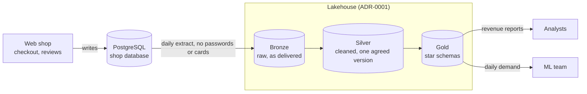

# Architecture

> Update this page at the end of every lesson. It is the diagram you present at
> the oral defence.

## Context

Albert's Marketplace is a European marketplace for beauty products. Today, one PostgreSQL database serves both the web shop and the analysts, so reports slow down checkout and two reports give two different revenue figures. The platform must serve two users: analysts, who need one agreed revenue figure, and the ML team, who need units sold per product, per country, per day. Daily freshness is enough for both; nothing needs real-time data. Two constraints matter: the shop's database must not carry analytical load, and passwords and card numbers must never leave it.

## Target architecture

The lakehouse choice is argued in [ADR-0001](adr/0001-target-architecture.md). Technologies are named here once an ADR chooses them.

## Layers

| Layer | What lands here | What it guarantees | Who reads it |
|---|---|---|---|
| Bronze | Daily extracts of the shop database, unchanged: duplicate orders and stray columns are kept. Passwords and card data are excluded at extraction. | Nothing that arrived is lost. | Data engineers only, to debug and rebuild silver. |
| Silver | Cleaned, typed tables: one row per real order, duplicates removed. | One agreed version of each fact. | The models that build gold. |
| Gold | Star schemas for named questions: `fct_daily_demand`, `dim_product`, `dim_country`, `dim_date`. | Each table answers a named question, at a declared grain. | Analysts and the ML team. |

## Decisions

| ADR | Decision | Status |
|---|---|---|
| [0001](adr/0001-target-architecture.md) | Adopt a lakehouse with bronze, silver and gold layers | Proposed |

## Change log

| Lesson | What changed |
|---|---|
| L01 | First version: context, target diagram, layer guarantees |